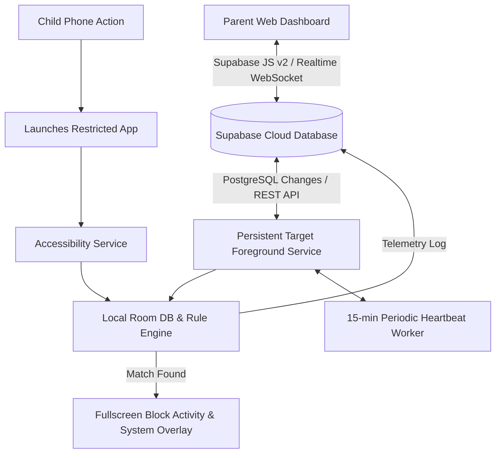

# 🛡️ Target Guard — Remote Parental Control & App Blocker

A complete, production-grade **Remote Parental Control and App Blocking Platform** featuring an ultra-low latency Android Target App and a real-time Parent Web Management Dashboard powered by **Supabase Realtime**.

---

## 🌟 Key Capabilities

### 📱 Android Target App (`com.remoteappblocker.target`)
- **Sub-300ms Launch Interception:** High-frequency event interception via `AccessibilityService` catches restricted package launches before the target UI is drawn.
- **Non-Bypassable Block Screen:** Fullscreen blocking activity with fallback `TYPE_APPLICATION_OVERLAY` system window overlay card, preventing recents/home bypass.
- **Dynamic Rule Engine:**
  - **Always Blocked (24/7):** Complete lockdown of restricted applications.
  - **Scheduled Window:** Enforces curfews and study hours with support for overnight wrap-around (e.g. `22:00` to `06:00`) and day-of-week selection.
  - **Daily Usage Limits:** Integrates with Android `UsageStatsManager` to enforce daily screen-time caps (e.g. max 45 minutes on games/social).
- **Anti-Tamper & Persistence:**
  - **Device Administrator API:** Prevents app uninstallation without parental PIN (`1234`).
  - **Foreground Service & Boot Receiver:** Resumes protection automatically on phone restart (`BOOT_COMPLETED`).
  - **OEM Autostart Guidance:** Detects Xiaomi, Samsung, Oppo, Vivo, Transsion/Infinix, and OnePlus aggressive battery killers.
- **Seamless Pairing:** Instant pairing via ZXing QR Code scanner and 6-digit numeric verification code.
- **Telemetry & Heartbeats:** 15-minute background WorkManager battery/health sync and real-time block event stream.

---

### 🌐 Parent Web Dashboard (`/web`)
- **Real-Time Control (<5s SLA):** Instant rule toggle switches with automatic version bumping pushed straight to target devices via Supabase Realtime.
- **Rule Customization Modal:** Configure schedules, days, daily minute caps, and custom messages shown to the child.
- **1-Click Emergency Focus Mode:** Instantly locks down all games and social entertainment apps (Instagram, YouTube, Roblox, BGMI, etc.).
- **Live Block Activity Feed:** Stream of intercepted attempts with exact timestamp and package identification.
- **Device Health KPIs:** Live battery percentage, accessibility status, active rule count, and total interceptions.

---

## 🏗️ Architecture & Data Flow



---

## 📂 Project Structure

```
.
├── app/                              # Android Target Application
│   ├── src/main/java/com/remoteappblocker/target/
│   │   ├── data/                     # Room Local DB, SharedPreferences, Supabase Repositories
│   │   ├── domain/                   # RuleEngine, TimeLimitTracker, Scanner, Models
│   │   ├── presentation/             # Jetpack Compose UI (Pairing, Wizard, Dashboard, BlockActivity)
│   │   ├── receiver/                 # BootCompletedReceiver, AdminReceiver
│   │   ├── service/                  # AccessibilityService, Persistent Foreground Service
│   │   ├── util/                     # PermissionUtils, OemAutostartHelper
│   │   └── worker/                   # HeartbeatWorker
│   └── src/main/AndroidManifest.xml  # Permissions, services, receivers, and device admin
├── web/                              # Parent Web Admin Portal
│   ├── index.html                    # Modern glassmorphism dark theme layout
│   ├── styles.css                    # Responsive CSS3 styles with vibrant glowing tokens
│   └── app.js                        # Supabase JS v2 client, Realtime subscriptions, and rule manager
├── supabase/
│   └── schema.sql                    # Full PostgreSQL database schema, RLS policies, and Realtime pub
├── build.gradle.kts                  # Root Gradle build script
└── README.md                         # Project documentation
```

---

## 🚀 Getting Started

### 1. Database Setup (Supabase)
1. Create a free project at [supabase.com](https://supabase.com).
2. Go to **SQL Editor** -> **New query**.
3. Run the SQL script located at [`supabase/schema.sql`](supabase/schema.sql).
4. The schema creates:
   - `devices`
   - `pairing_codes`
   - `installed_apps`
   - `rules`
   - `block_events`
   - Configures RLS policies and enables Realtime publications.

---

### 2. Running Parent Web Portal
Open [`web/index.html`](web/index.html) in any modern browser, or run a local HTTP server:
```bash
cd web
python -m http.server 3000
```
Navigate to `http://localhost:3000`.

---

### 3. Building & Installing the Target App
Prerequisites: Android SDK 34, JDK 17.

```bash
# Clone the repository
git clone https://github.com/imteyazzzz/target-guard.git
cd target-guard

# Build the Debug APK
./gradlew assembleDebug

# Install via ADB to connected phone
adb install -r app/build/outputs/apk/debug/app-debug.apk
```

#### Fast Permission Grant via ADB (Optional for Developers):
```bash
adb shell appops set com.remoteappblocker.target.debug SYSTEM_ALERT_WINDOW allow
adb shell appops set com.remoteappblocker.target.debug GET_USAGE_STATS allow
adb shell dumpsys deviceidle whitelist +com.remoteappblocker.target.debug
adb shell settings put secure enabled_accessibility_services com.remoteappblocker.target.debug/com.remoteappblocker.target.service.AppBlockerAccessibilityService
adb shell settings put secure accessibility_enabled 1
```

---

## 🔒 Security & Anti-Bypass Protections
1. **Admin PIN:** Default unpair PIN is `1234`. Device protection cannot be removed from the child phone without it.
2. **Prevent Uninstall:** Protected by `DeviceAdminReceiver` via the Android Device Administration API.
3. **Overlay & Touch Defense:** The block overlay absorbs all touch inputs and immediately redirects user navigation to the home launcher.
4. **Heartbeat Monitoring:** The child phone transmits a health telemetry payload every 15 minutes reporting battery life and accessibility service state.

---

## 📄 License
This project is open-source and available under the [MIT License](LICENSE).
